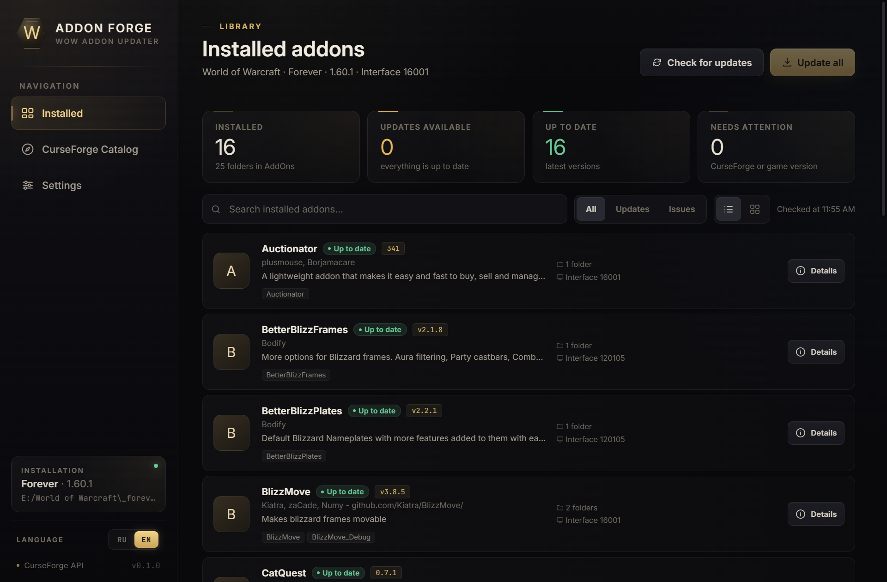
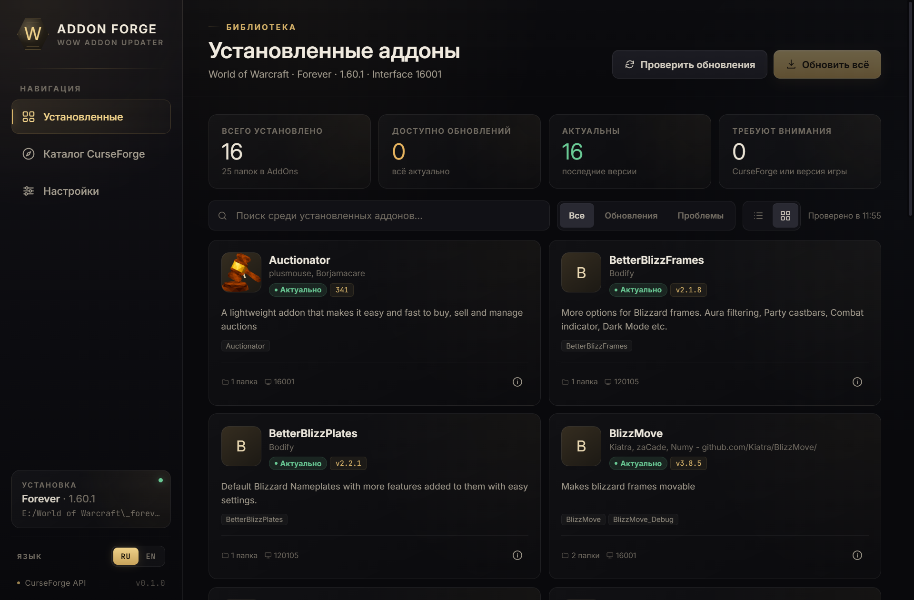
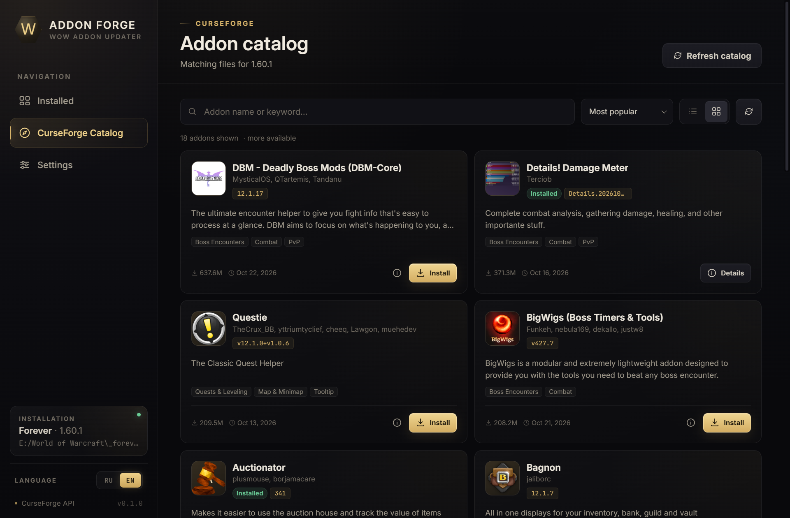
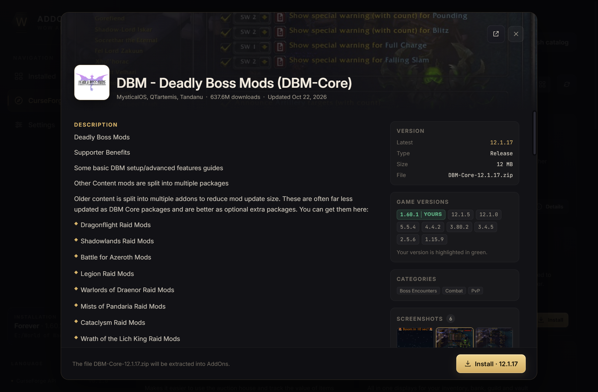

# Addon Forge

Addon Forge is a desktop World of Warcraft addon manager for Windows, built with
**Rust + Tauri 2**. It discovers your WoW installation, reads the addons already in
`Interface/AddOns`, checks them against CurseForge, and installs updates or new
addons with one click.

The interface has a dark WoW-inspired theme, ships with a bundled **Inter** and
**JetBrains Mono** typography setup, and works fully offline apart from CurseForge
requests. The frontend is plain HTML/CSS/JavaScript embedded in the Tauri binary, so
no Node.js runtime is required to use the app.



## Features

- **English and Russian UI** — switch languages from the sidebar. The choice is
  saved in the application config and restored on the next launch.
- **Install detection** — scans the Battle.net configuration, common drive paths,
  and a manually selected folder. Supports Retail, Classic, Classic Era, and Forever
  (`_retail_`, `_classic_`, `_classic_era_`, `_forever_`, …).
- **Installed addon list** — reads TOC metadata, groups multi-folder addons
  (`Questie` + `QuestieDB`, Details modules, …), and resolves CurseForge project IDs
  from `X-Curse-Project-ID`, CurseForge URLs, titles, folder names, and slugs.
- **Update checking** — picks the newest stable file for the local interface version,
  with a same-major/minor fallback when the exact patch is not published.
- **Catalog search** — popular, recently updated, and alphabetical sorting, paging,
  installed badges, descriptions, a full-screen screenshot gallery, and supported
  game versions with your local version highlighted in green.
- **Grid and list views** — both the installed addon list and the CurseForge catalog
  can be switched between compact rows and cards; the preference is remembered.
- **Context actions** — right-click an addon to install, reinstall, open details, or
  remove it. Double-clicking an installed addon or catalog item opens its details.
  Removal asks for confirmation and keeps a backup when backups are enabled.
- **Safe install** — validates ZIP paths, rejects traversal entries, downloads to a
  local staging area, creates a backup of replaced folders, and only then swaps files
  into `Interface/AddOns`.
- **Manifest** — remembers the CurseForge project and file ID for each installed
  addon so future checks do not depend on fragile title matching.
- **Portable build** — an installer-free EXE that keeps settings, downloads, and
  backups in a `data` folder next to the executable.

## Screenshots

| English | Русский |
| --- | --- |
|  |  |

| CurseForge catalog | Addon details |
| --- | --- |
|  |  |

## Download

Prebuilt Windows artifacts are available from the repository's **Releases** page:

- **MSI installer** — Windows Installer package with Start Menu integration;
- **NSIS installer** — standard Windows setup;
- **portable ZIP** — unpack anywhere and run `Addon Forge.exe`.

The builds are currently unsigned, so Windows SmartScreen may ask for confirmation.
Choose **More info → Run anyway** after verifying that the file came from this
repository.

## Requirements

To use a release build:

- Windows 10/11;
- Microsoft Edge WebView2 Runtime (already included with current Windows versions).

To build from source:

- [Rust](https://rustup.rs/) stable toolchain;
- [Node.js](https://nodejs.org/) 20 or newer;
- WebView2 runtime.

## Development

```powershell
npm install
npm run dev
```

Other useful commands:

```powershell
npm run check      # cargo check
npm run test       # backend test suite
npm run build      # MSI and NSIS installers
npm run portable   # portable EXE and ZIP
```

Build output:

- installers: `src-tauri/target/release/bundle/`;
- portable app: `dist/AddonForge-portable/Addon Forge.exe`;
- portable archive: `dist/AddonForge-portable.zip`.

The portable build uses Cargo feature `portable`. It stores its config, manifest,
downloads, and backups in a `data` folder next to the executable. Move the whole
folder when copying the app to another computer.

## Continuous integration

`.github/workflows/windows.yml` runs on pushes to `main`, pull requests, manual
dispatches, and `v*` tags. It installs the Rust and Node toolchains, runs the backend
tests, builds the MSI installer, the NSIS setup, and the portable ZIP. A version tag
publishes all three files as separate assets in **GitHub Releases**.

To publish a new version, bump the version in `package.json`,
`src-tauri/Cargo.toml`, and `src-tauri/tauri.conf.json`, then push a matching tag:

```powershell
git tag v0.1.0
git push origin v0.1.0
```

## Data and privacy

Addon Forge does not collect telemetry. The CurseForge API key, when used, is stored
only in the local configuration file and is sent only to the selected CurseForge API
endpoint.

Regular builds use:

- config: `%APPDATA%\WowAddonUpdater\config.json`
- manifest: `%LOCALAPPDATA%\WowAddonUpdater\manifest.json`
- backups: `%LOCALAPPDATA%\WowAddonUpdater\backups`
- downloads: `%LOCALAPPDATA%\WowAddonUpdater\downloads`

Portable builds keep the same files under `data` next to the executable. All locations
are shown in **Settings → Local storage**.

## CurseForge API

By default Addon Forge uses the public keyless proxy:

```text
https://api.curse.tools/v1/cf
```

In **Settings → CurseForge API** you can switch to the official API:

```text
https://api.curseforge.com/v1
```

The official API requires a personal key from the
[CurseForge Console](https://console.curseforge.com/). The key is stored only in the
local configuration file.

## Project layout

```text
ui/                     static frontend (HTML, CSS, JavaScript)
  index.html
  app.js
  i18n.js               locale detection, static translations, plurals
  styles.css
  fonts/                bundled Inter / JetBrains Mono + OFL licenses
src-tauri/
  src/
    main.rs             Tauri entry point
    commands.rs         Tauri commands, DTOs, and progress events
    config.rs           persisted settings and local paths
    curseforge.rs       CurseForge client, resolution, file selection
    wow.rs              install detection and TOC parsing
    installer.rs        ZIP validation, backups, manifest, atomic install
    models.rs           shared data types
    html.rs             HTML/Markdown description normalization
  capabilities/         Tauri permissions
  icons/                application and bundle icons
  tauri.conf.json
  Cargo.toml
scripts/
  build-portable.mjs
docs/screenshots/
.github/workflows/
```

## License

MIT. See [LICENSE](LICENSE).
